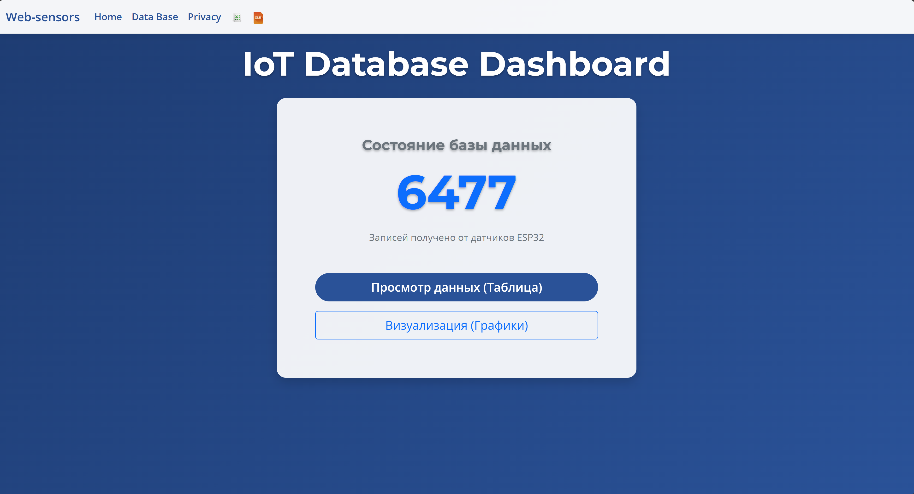
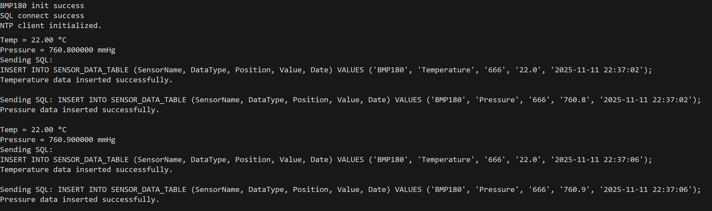
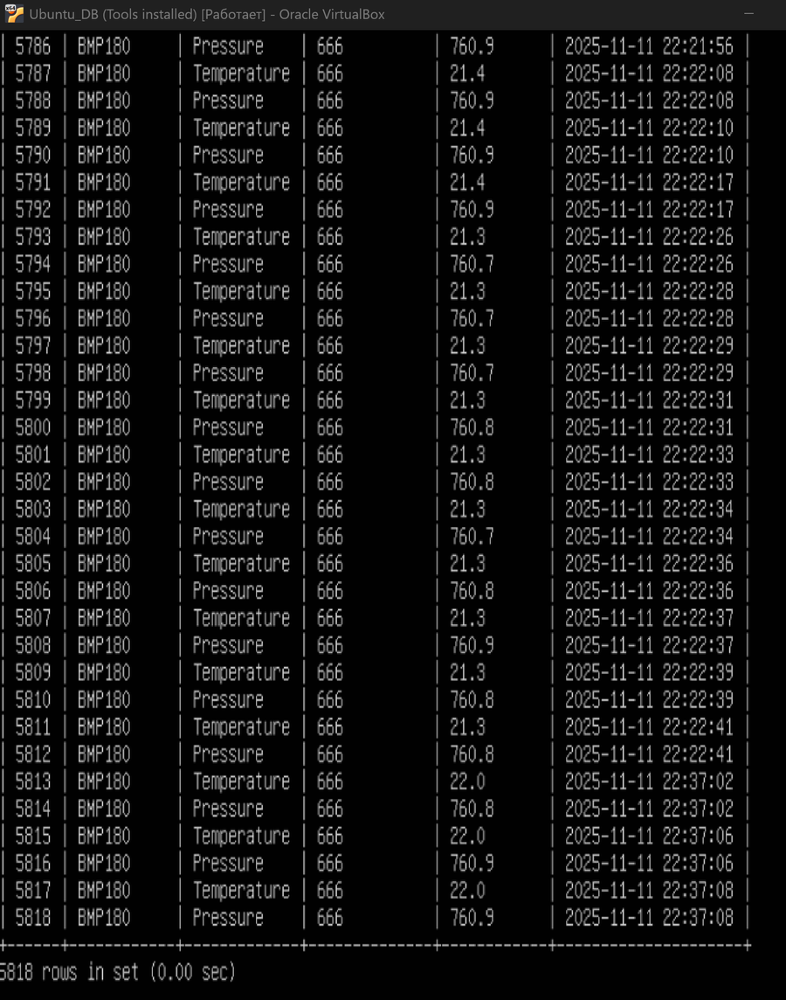

# IoT Sensor Data Management Web Application

ASP.NET Core MVC web application for browsing, charting and exporting sensor measurements that an ESP32-based device stores in a MySQL database. Academic project covering the path from sensor data to a remotely accessible web interface.

## Screenshots



## Data Source

The ESP32 reads a BMP180 sensor, connects to MySQL over Wi-Fi and inserts a temperature row and a pressure row on every cycle (serial monitor below). The rows then appear in `SENSOR_DATA_TABLE` and are what the web application reads.





## Features

- **Dashboard:** total number of records received from the sensors.
- **Data table:** archive of readings with filters by sensor name, data type, position and date range, newest first.
- **Time-series chart:** line chart of the selected measurement type (for example, temperature) over a chosen interval, drawn with Google Charts.
- **Export:** the current filtered selection (or the whole table) as an Excel `.xlsx` file (ClosedXML) or as XML.
- **Remote access:** the application ran on a Linux virtual machine behind a web server and was published through a Cloudflare Tunnel.

## Architecture

```text
ESP32 (sensors) --> MySQL database --> ASP.NET Core MVC --> browser
                                         |-- table + filters
                                         |-- chart
                                         |-- Excel / XML export
```

The ESP32 firmware is not part of this repository. Embedded work is collected in [Embedded-Software-Projects](https://github.com/DiemerSergeev/Embedded-Software-Projects).

## Database

The application reads one table, by default `SENSOR_DATA_TABLE` in the `SENSOR_DB` schema, with these columns:

| Column | Content |
|--------|---------|
| `Id` | record number |
| `SensorName` | sensor name (for example, BMP180) |
| `DataType` | measured quantity (for example, Temperature) |
| `Position` | sensor position number |
| `Value` | measured value |
| `Date` | time of the measurement |

Filter values are passed to MySQL as query parameters.

## Tech Stack

C#, ASP.NET Core MVC (.NET 8), MySql.Data, ClosedXML, Razor views, Bootstrap, Google Charts. ESP32 as the data source; Linux VM and Cloudflare Tunnel for deployment.

## Repository Structure

```text
Tsk3/
  Tsk3.sln
  Tsk3/
    Controllers/   DataBaseController (table, chart, export), HomeController
    Models/        ConnectionParameters, DataBaseModel (queries), DataBaseItem
    Views/         Razor views: dashboard, table, chart, shared layout
    wwwroot/       Static files and icons
    Program.cs     Startup and database configuration
```

## Configuration and Run

Connection settings are read from the `Database` section of `appsettings.json`. The file contains empty defaults; real values are set with environment variables and are not stored in the repository:

```text
Database__Server=<mysql host>
Database__Port=3306
Database__Name=SENSOR_DB
Database__Table=SENSOR_DATA_TABLE
Database__User=<read-only user>
Database__Password=<password>
```

Run from the `Tsk3/Tsk3` folder with the .NET 8 SDK:

```text
dotnet run
```

The chart page loads Google Charts from a CDN, so it needs internet access in the browser.
